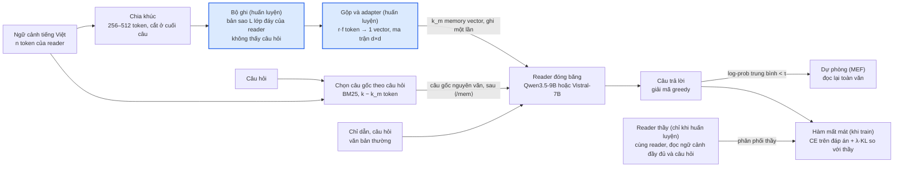
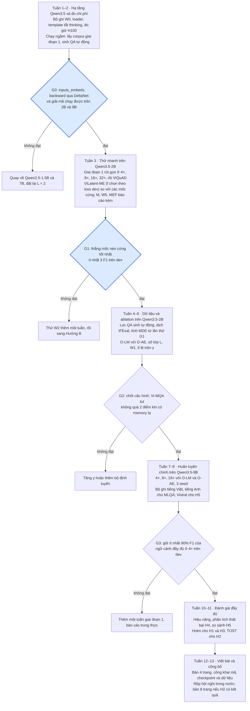

# ViLatent: nén mềm ngữ cảnh cho reader tiếng Việt đóng băng

> Đề xuất nghiên cứu, cập nhật ngày 16/10/2026. Bản gốc là một Claude Doc:
> <https://claude.ai/code/artifact/6f8e2105-9e97-4eaa-88c4-91cbad2b33f0>.
> File này được xuất từ bản gốc để tham chiếu khi viết code. Khi hai bản lệch nhau, sửa cả hai.
> Hai sơ đồ trong bản gốc được vẽ lại bằng Mermaid.
>
> **Sửa đổi 16/10/2026 (chưa đồng bộ sang bản Claude Doc):** đổi cơ chế đọc. Bộ ghi vẫn không thấy câu hỏi và
> ghi memory một lần, nhưng hệ chính (ViLatent-ME) thêm câu gốc chọn theo câu hỏi trong cùng ngân sách k (phần
> chia cho memory theo hệ số f ∈ {2, 4, 8}, chọn theo loss dev), kèm
> cơ chế dự phòng đọc toàn văn khi reader không chắc (ViLatent-MEF) và nhánh so sánh W5 (bộ ghi thấy câu hỏi).
> Lý do và bằng chứng ở mục "Nén có điều kiện theo câu hỏi" và "Đọc theo câu hỏi". Các mục bị ảnh hưởng:
> tóm tắt, tổng quan, giả thuyết H1, H6, H7, kiến trúc, huấn luyện, thiết kế thực nghiệm, G1, rủi ro, tài liệu
> tham khảo [15]–[24].

## Tóm tắt và động cơ

ViLatent nén ngữ cảnh tiếng Việt thành k vector (memory token) để một LLM reader đóng băng đọc thẳng qua lớp embedding, thay cho việc giữ hay bỏ chữ như ViWord-C. Mục tiêu đo được là ở tỉ lệ nén 4–16× giữ ít nhất 90% điểm QA so với ngữ cảnh đầy đủ. Đồng thời phải thắng các mốc truncation, chọn câu và LLMLingua-2 khi cùng ngân sách token của reader.

Bộ ghi không thấy câu hỏi, nên memory được ghi một lần và dùng lại cho mọi câu hỏi. Nén mù câu hỏi có thể làm mất đúng chi tiết mà câu hỏi đến sau cần, nhất là con số, ngày tháng và tên riêng. Vì vậy hệ chính không chỉ đọc memory: lúc đọc, khi đã có câu hỏi, một phần ngân sách dành cho các câu gốc chọn theo câu hỏi, và khi reader không chắc thì đọc lại toàn văn. Không cơ chế nén nào bảo đảm giữ đủ thông tin; chỉ việc quay về văn bản gốc mới tiến gần tới bảo đảm, nên đường quay về được giữ trong thiết kế.

Vì sao chọn hướng này:

- Nén cứng (hard compression) đã chạm trần trong thực nghiệm của chính nhóm. Ở LACC, truncation hòa hoặc thắng bộ nén học được, và chọn theo câu vượt xa chọn theo token ở mức 8×. Nén mềm không phải giữ nguyên chữ nên tránh được giới hạn này.
- Các công trình 2025–2026 cho thấy chỉ cần huấn luyện một adapter nhỏ, cỡ 0,1% tham số của reader. LatentPress đạt độ chính xác 0,504 ở mức nén 7,7× so với 0,490 khi dùng ngữ cảnh gốc trên LongMemEval.
- Chưa tìm thấy công trình nào nén mềm cho tiếng Việt, hay nói rộng hơn là nén ngữ cảnh không phải tiếng Anh vào soft token.

Đóng góp dự kiến:

1. Bộ nén mềm đầu tiên cho tiếng Việt dùng reader đóng băng, công khai mã, checkpoint và dữ liệu.
2. So sánh có kiểm soát giữa nén mềm và nén cứng trên cùng ngân sách token của reader, kèm thí nghiệm song song Việt–Anh để tách hiệu ứng ngôn ngữ.
3. Đánh giá năng lực ngoài tài liệu (off-context), như kiến thức chung và tuân thủ chỉ dẫn, cùng phân tích kiểu thất bại riêng cho tiếng Việt: thực thể, con số, phủ định.
4. Đo lợi ích của nén mềm trên reader kiến trúc lai (Qwen3.5) so với transformer thuần (Vistral). Chưa công trình nào trong phần tổng quan làm việc này.
5. Đo cái giá của việc nén mù câu hỏi trên tiếng Việt: cùng bộ ghi, cùng reader đóng băng, cùng tỉ lệ, chỉ khác bộ ghi có thấy câu hỏi hay không. Cùng với đó là một cơ chế đọc lai (memory ghi một lần cộng câu gốc chọn theo câu hỏi) và đường đánh đổi chất lượng–chi phí khi cho phép đọc lại toàn văn.

Phạm vi: reader chính là họ Qwen3.5 (2B và 9B, kiến trúc lai Gated DeltaNet), với Vistral-7B làm đối chứng transformer thuần. Tác vụ gồm QA một tài liệu, QA nhiều tài liệu và tóm tắt. Mọi reader chạy ở chế độ trả lời trực tiếp (tắt thinking). Không nhắm tới API đóng vì nén mềm cần truy cập lớp embedding.

## Tổng quan công trình liên quan

Các công trình gần đây đều đi theo một hướng: reader để đóng băng, chỉ huấn luyện bộ ghi nhỏ, và huấn luyện thẳng theo câu trả lời thay vì chỉ tái tạo văn bản. Bảng dưới đây lấy số liệu từ các trang bài báo đã mở.

| Công trình | Bộ ghi và giao diện với reader | Huấn luyện | Kết quả đáng chú ý | Bài học cho ViLatent |
| --- | --- | --- | --- | --- |
| [ICAE](https://arxiv.org/abs/2307.06945) (ICLR 2024) | Chính LLM với khoảng 1% tham số thêm, sinh memory slot | Pretrain bằng autoencoding (AE) và LM, rồi tinh chỉnh theo chỉ dẫn | Nén 4× trên Llama | Mốc so sánh nén mềm kinh điển, phải có trong bảng |
| [500xCompressor](https://arxiv.org/abs/2408.03094) | LoRA, khoảng 0,3% tham số, xuất giá trị KV | Pretrain trên ArxivCorpus, tinh chỉnh trên ArxivQA | Nén 6–480×, giữ 62,26–72,89% năng lực | Giá trị KV giữ thông tin tốt hơn embedding khi nén cao |
| [xRAG](https://arxiv.org/abs/2405.13792) (NeurIPS 2024) | Embedding của retriever qua một cầu nối, 1 token | Chỉ huấn luyện cầu nối | Giảm FLOPs 3,53× | Cấu hình cực đoan, dùng làm cận dưới |
| [SAC](https://arxiv.org/abs/2510.08907) | Chọn token giữa mỗi khúc làm anchor, thêm anchor embedding và attention hai chiều, LoRA r=128 trên Llama-3.2-1B | Pretrain chỉ với loss LM trên SlimPajama, không dùng AE; tinh chỉnh QA trên MRQA | Ở 15×: 54,95 ROUGE-1 so với 49,35 của 500x và 31,83 của LLMLingua-2 (5×) | Gradient của AE và LM nhanh chóng trực giao, nên AE có thể cản trở tác vụ. Cần kiểm lại trên tiếng Việt |
| [LatentPress](https://arxiv.org/abs/2609.01507) | Sao chép 2 lớp đáy của reader, mean pooling, adapter tuyến tính d×d khởi tạo bằng ma trận đơn vị; đưa vào qua `inputs_embeds` | L = CE + λ·KL thuận từ reader đọc ngữ cảnh đầy đủ; 1.000 bước, lr 1e-4 | Qwen2.5-7B trên LongBench-QA trong miền: 49,06 / 43,77 / 37,78 ở 4× / 8× / 16×, so với 43,80 khi đọc thô | Thiết kế rẻ nhất, dùng làm bộ khung gốc của ViLatent |
| [CMC](https://arxiv.org/abs/2609.25537) | Encoder riêng (GPT2-Large, OPT) với token `<MEM>`, MLP cầu nối; KV hai tầng: chọn top-K CME theo câu hỏi và cửa sổ cục bộ | Pha 1: AE và AR. Pha 2: CE + 0,5·KL + 0,1·contrastive | SQuAD với Llama: EM 48,28 → 55,56; Mistral tụt từ 45,36 xuống 30,67 | Bài mô tả cửa sổ cục bộ đặt quanh vị trí đáp án vàng. Dùng lúc suy luận sẽ là rò rỉ, ViLatent không chép phần này |
| [Nghiên cứu gist](https://arxiv.org/abs/2412.17483) | Fine-KV trên Llama3.1-8B, nén 4–32× | Thêm AE mịn và ước lượng tầm quan trọng token (TIE) | Recall tổng hợp 40,6 ở 4× so với 93,9 khi dùng attention đầy đủ; AE nâng lên 62,0 | Ba kiểu thất bại (lost by the boundary, lost if surprise, lost along the way) là khung phân tích cho H4 |
| [Cartridges++](https://arxiv.org/abs/2609.35621) | Cartridge (KV học được) kèm bộ định tuyến kNN | Trộn 1–5% token huấn luyện là ví dụ ngoài tài liệu, dùng reader gốc làm thầy | Router nhận hơn 90% câu hỏi trong tài liệu và từ chối hơn 90% câu ngoài tài liệu | Đo off-context bằng TinyMMLU, IFEval và một LLM trọng tài; áp dụng cho H3 |
| [Lost in Compression](https://arxiv.org/abs/2608.26175) | Kiểm toán các bộ nén trích xuất (LLMLingua-2, Kompress-v2, XProvence) trên 10 ngôn ngữ | — | Ở tỉ lệ giữ 0,33: tiếng Anh giữ 57–62% mức tận dụng ngữ cảnh, tiếng Litva 10–24%, tiếng Trung gần 0 | Khoảng cách này đến từ dữ liệu huấn luyện bộ nén. Không xác nhận được bài có tiếng Việt hay không |

Trong danh sách gốc còn Dodo (số trạng thái ẩn động mỗi lớp) và IC-Former (cross-attention với digest token, nhanh hơn 68–112×). Cả hai là biến thể kiến trúc, sẽ xét trong ablation nếu còn thời gian. Khoảng trống mà ViLatent nhắm tới: chưa bài nào ở trên đánh giá trên tiếng Việt. Cũng chưa bài nào so sánh nén mềm với nén cứng trên dữ liệu song song giữa nhiều ngôn ngữ.

### Nén có điều kiện theo câu hỏi, cơ chế lai và dự phòng

Phần này được thêm sau lượt tra cứu ngày 16/10/2026 (WebSearch và arXiv API, khoảng 40 truy vấn, 31 bài đọc toàn văn hoặc phần liên quan). Mọi mã arXiv dưới đây đã được kiểm qua arXiv API; số liệu lấy từ toàn văn, kèm vị trí. Câu hỏi đặt ra: nén mà không thấy câu hỏi mất gì, và làm sao giảm rủi ro đó mà vẫn giữ được memory ghi một lần.

| Công trình | Câu hỏi được dùng ở đâu | Kết quả đáng chú ý | Bài học cho ViLatent |
| --- | --- | --- | --- |
| [QGC](https://arxiv.org/abs/2406.02376) [15] (ACL 2024) | Câu hỏi đi cùng tài liệu vào bộ nén; gộp n-gram có trọng số theo câu hỏi | NQ, LongChat-13B: 69,19; bỏ bộ mã hóa dẫn bởi câu hỏi còn 50,36; thay gộp theo câu hỏi bằng gộp trung bình còn 55,34 (Bảng 2) | Thấy câu hỏi giúp nhiều khi nén mạnh, nhưng mỗi cặp (câu hỏi, tài liệu) phải nén lại |
| [OSCAR](https://arxiv.org/abs/2504.07109) [16] | (câu hỏi, tài liệu, memory token) qua bộ nén; một biến thể dùng N lớp đầu của chính generator | Ở ×16, bản không dùng câu hỏi đạt 0,73 so với 0,77; generator đóng băng chỉ đạt 0,71 so với 0,77 (Bảng 2) | Bộ nén thấy câu hỏi kết hợp reader đóng băng chưa được chứng minh |
| [AdaMem](https://arxiv.org/abs/2609.22100) [17] | Huấn luyện lại PISCO (mù câu hỏi) và OSCAR (thấy câu hỏi) cùng dữ liệu, cùng siêu tham số | Ở 16×: HotpotQA 38,4 so với 44,1; NQ 58,9 so với 62,8 (Bảng 1) | Phép so sánh cùng ngân sách sạch nhất tìm được: chênh khoảng 3–6 điểm |
| [KVzip](https://arxiv.org/abs/2505.23416) [18] (NeurIPS 2025) | Đối chứng: các phương pháp loại KV theo câu hỏi (SnapKV…) | Giảm chất lượng "ngay cả với 90% ngân sách cache" khi một cache dùng cho nhiều câu hỏi (tóm tắt) | Đưa câu hỏi vào lúc ghi làm mất khả năng dùng lại |
| [ReadAgent](https://arxiv.org/abs/2402.09727) [19] | Gist dạng văn bản mù câu hỏi; tra lại trang gốc theo câu hỏi | QuALITY, PaLM 2-L: chỉ gist 77,52; tra 1–2 trang 86,16; toàn văn 85,83 (Bảng 1) | Lấy lại văn bản gốc phục hồi phần lớn thông tin mất |
| [SeDeM](https://arxiv.org/abs/2608.00311) [20] (EMNLP 2026) | Memory trạng thái ẩn mù câu hỏi; bộ chọn học được chọn khối theo câu hỏi | TTFT nhanh hơn ICAE 1,74–2,46× (tóm tắt); MuSiQue F1 21,85 so với 32,54 khi tinh chỉnh toàn văn (Bảng 1) | Giữ được ghi một lần; câu hỏi nhiều bước vẫn yếu |
| [LensVLM](https://arxiv.org/abs/2605.07019) [21] (NeurIPS 2026) | Ngữ cảnh nén dạng ảnh; công cụ mở rộng trả lại văn bản gốc của trang được chọn | Ở 5×: chỉ ảnh nén 31,3%, có mở rộng 68,9%, cận trên văn bản 72,4% (mục 4.2) | Mở rộng có chọn lọc về văn bản gốc là bước phục hồi lớn nhất |
| [Self-Route](https://arxiv.org/abs/2407.16833) [22] (EMNLP 2024 Industry) | Reader nhận ngữ cảnh rẻ và câu hỏi, được phép trả lời "không trả lời được"; khi đó chuyển sang toàn văn | GPT-4o: 46,83 so với 47,04 khi đọc toàn văn, dùng 61% số token (Bảng 1) | Dự phòng giữ chất lượng gần toàn văn với chi phí thấp hơn; không bắt được câu trả lời sai mà tự tin |
| [Sufficient Context](https://arxiv.org/abs/2411.06037) [23] | Bộ chấm "ngữ cảnh có đủ không" | Gemini 1.5 Pro 1-shot đúng 93% (Bảng 1); LLM vẫn trả lời đúng 35–62% khi ngữ cảnh không đủ | Tín hiệu "đủ hay không" hữu ích nhưng không hoàn hảo |
| [Łajewska và cộng sự](https://arxiv.org/abs/2503.19114) [24] (EMNLP 2025 Findings) | Phân tích thông tin còn giữ sau nén mềm | xRAG chỉ giữ 0,22 thực thể ngày tháng và 0,26 số đếm (Bảng 7); đề xuất giữ số và tên ở dạng token cứng | Ủng hộ việc đưa câu gốc nguyên văn bên cạnh memory |

Tổng hợp: (1) không cơ chế nào bảo đảm memory còn giữ dữ kiện mà một câu hỏi chưa biết sẽ cần; chỉ đường quay về văn bản gốc mới tiến gần tới bảo đảm; (2) thấy câu hỏi lúc ghi giúp 3–6 điểm cùng ngân sách nhưng mất khả năng ghi một lần [17], [18]; (3) giữ memory mù câu hỏi rồi dùng câu hỏi lúc đọc (chọn, tra lại văn bản gốc, hoặc dự phòng) giữ được ghi một lần và phục hồi nhiều nhất [19], [21], [22]. Trong phạm vi tìm kiếm trên, chưa thấy công trình nào làm nén có điều kiện theo câu hỏi cho tiếng Việt (CMC [6] tự nhận chỉ làm tiếng Anh), và chưa thấy bài nào cô lập phép so sánh "cùng bộ ghi, reader đóng băng, có và không có câu hỏi, cùng tỉ lệ".

## Câu hỏi nghiên cứu và giả thuyết

Đề tài có bảy giả thuyết. H1 và H3 là giả thuyết xác nhận, có kiểm định và hiệu chỉnh Holm. H2 là giả thuyết xác nhận nhưng được thiết kế để kết quả null vẫn công bố được. H4, H5, H6 và H7 chỉ là phân tích mô tả. "ViLatent" trong H1–H3 là hệ chính ViLatent-ME (mục "Đọc theo câu hỏi"). Ngân sách được đo bằng token của reader: tỉ lệ nén = số token ngữ cảnh gốc chia cho số memory token. Mốc nén cứng được cấp cùng số token đó.

- **RQ1:** Cùng ngân sách token của reader, nén mềm có thắng nén cứng trên QA tiếng Việt không?
- **RQ2:** Mức chênh lệch giữa nén mềm và nén cứng có khác nhau giữa tiếng Việt và tiếng Anh trên cùng một nội dung không?
- **RQ3:** Mục tiêu huấn luyện (có hay không có AE, có hay không trộn dữ liệu ngoài tài liệu) đánh đổi giữa điểm trong tài liệu và năng lực ngoài tài liệu ra sao?
- **RQ4:** Nén mềm làm mất loại thông tin nào trong tiếng Việt?
- **RQ5:** Lợi ích của nén mềm khác nhau thế nào giữa reader kiến trúc lai và reader transformer thuần?
- **RQ6:** Nén mù câu hỏi làm mất bao nhiêu so với nén thấy câu hỏi, khi cùng bộ ghi, cùng reader đóng băng và cùng ngân sách?
- **RQ7:** Cho phép đọc lại toàn văn khi reader không chắc thì tốn thêm bao nhiêu token để giữ được chất lượng gần toàn văn?

| Giả thuyết | Dự đoán | Đo bằng | Bác bỏ khi |
| --- | --- | --- | --- |
| H1, nén mềm thắng nén cứng | Ở 4× và 8×, F1 của ViLatent cao hơn mốc nén cứng tốt nhất (truncation, chọn câu, LLMLingua-2) ít nhất 3 điểm. Ở 4× giữ ít nhất 90% F1 so với ngữ cảnh đầy đủ | F1/EM trên UIT-ViQuAD 2.0 và QA đa tài liệu; bootstrap cặp theo cụm đoạn văn | Khoảng tin cậy 95% của chênh lệch chứa 0 ở cả hai tỉ lệ nén |
| H2, hiệu ứng ngôn ngữ | Δ (mềm trừ cứng) ở tiếng Việt lớn hơn ở tiếng Anh, vì bộ nén cứng mất nhiều hơn với ngôn ngữ không phải tiếng Anh | Cùng bộ QA song song Việt–Anh; kiểm định tương tác ngôn ngữ × phương pháp; TOST với biên ±2 F1 sau khi tính MDE | Khoảng tin cậy của tương tác nằm trọn trong ±2 F1, tức tương đương. Đây là kết quả null có ý nghĩa và vẫn được báo cáo |
| H3, đánh đổi theo mục tiêu huấn luyện | Huấn luyện theo câu trả lời không có AE thắng có AE trên QA trong tài liệu, nhưng kém hơn ngoài tài liệu. Trộn 5% dữ liệu ngoài tài liệu lấy lại ít nhất 80% khoảng hụt đó và mất không quá 1 điểm F1 | F1 trong tài liệu; kiến thức chung tiếng Việt, tuân thủ chỉ dẫn và tỉ lệ nhiễm ngữ cảnh theo cách đo của Cartridges++ | Trộn dữ liệu không thu hẹp được khoảng hụt, hoặc làm F1 trong tài liệu tụt quá 1 điểm |
| H4, kiểu thất bại (mô tả) | Mức tụt F1 lớn nhất ở câu hỏi có đáp án là số và thực thể tên riêng, ở đáp án nằm sát ranh giới khúc, và ở câu có phủ định | Phân tầng F1 theo loại đáp án và vị trí trong khúc; probe kim (needle) là số hoặc từ; hồi quy logistic | Không bác bỏ, chỉ báo cáo hệ số kèm khoảng tin cậy |
| H5, kiến trúc lai và transformer thuần (mô tả) | Không đặt hướng cho mức giữ F1. Về hiệu năng, TTFT giảm ở cả hai reader. Bộ nhớ giảm ít hơn nhiều ở Qwen3.5-9B, vì chỉ 8 trong 32 lớp có KV cache | Mức giữ F1 so với ngữ cảnh đầy đủ của chính reader đó; TTFT; bộ nhớ đỉnh gồm KV và trạng thái DeltaNet | Không bác bỏ, chỉ báo cáo khoảng tin cậy. Hai reader khác nhau cả về dữ liệu, kích thước và tokenizer, nên không quy kết quả riêng cho kiến trúc |
| H6, cái giá của nén mù câu hỏi (mô tả) | W5 (bộ ghi thấy câu hỏi) hơn W0 ở cùng tỉ lệ; mức chênh lớn nhất ở đáp án là số và thực thể, như [17], [24] gợi ý | F1 của ViLatent-M (W0) và W5, cùng r, cùng giai đoạn 1; phân tầng theo loại đáp án như H4; ViLatent-ME đặt cạnh để xem đọc lai bù được bao nhiêu | Không bác bỏ, chỉ báo cáo chênh lệch kèm khoảng tin cậy bootstrap theo đoạn |
| H7, đánh đổi khi cho phép đọc lại (mô tả) | Với ngưỡng τ chọn trên dev, ViLatent-MEF đạt ít nhất 95% F1 của toàn văn mà phần lớn câu hỏi vẫn chỉ đọc memory | Đường F1 theo số token trung bình khi τ thay đổi; tại τ cố định: F1, tỉ lệ đọc lại, số token trung bình, tỉ lệ câu sai mà reader vẫn tự tin | Không bác bỏ, chỉ báo cáo. τ chốt trên dev trước khi chạy test |

Về H2 cần thận trọng. LACC từng thấy tiếng Việt không bị thiệt hơn các ngôn ngữ khác (τ trong khoảng ±0,02), nên H2 có thể không đúng. TOST chỉ có nghĩa khi đủ mẫu: cần tính MDE trước khi chạy, không lặp lại lỗi TOST thiếu lực kiểm định của LACC.

Cách đặt ngân sách cho H2:

- Phân tích chính dùng cùng tỉ lệ r trong mỗi ngôn ngữ, nên với cùng nội dung, tiếng Việt nhận nhiều memory token hơn tiếng Anh.
- Phân tích phụ cố định cùng số memory token k cho cùng một nội dung, nghĩa là tiếng Việt bị nén chặt hơn.
- Cả code huấn luyện lẫn code đánh giá đều tính ngân sách bằng một hàm chung.

MDE được ước lượng từ phương sai của lần chạy thử ở G1, vì ViWord-C chưa có kết quả đầy đủ để lấy làm căn cứ.

## Kiến trúc ViLatent

Khung gốc theo LatentPress vì đây là thiết kế rẻ nhất đã được kiểm chứng: bộ ghi là bản sao vài lớp đáy của reader, cộng một adapter tuyến tính. Reader nhận memory token qua `inputs_embeds`. Các biến thể khác chỉ dùng trong ablation.



*Hình: hệ chính ViLatent-ME (và nhánh dự phòng MEF). Chỉ bộ ghi và adapter (tô màu) được huấn luyện; reader
luôn đóng băng. Memory không phụ thuộc câu hỏi nên ghi một lần; câu hỏi chỉ được dùng lúc đọc, để chọn câu gốc
và để quyết định có đọc lại toàn văn hay không. Khi huấn luyện, gradient đi ngược qua reader đóng băng để cập nhật
hai khối tô màu; câu gốc là văn bản nên không có gradient.*

Memory của một tài liệu được ghi một lần rồi dùng lại cho mọi câu hỏi. Reader thầy chính là reader đóng băng khi đọc ngữ cảnh đầy đủ.

**Thành phần của khung gốc (W0):**

1. **Chia khúc theo câu.** Ngữ cảnh được cắt thành các khúc 256–512 token của reader, ranh giới luôn rơi vào cuối câu. Lý do: cắt giữa câu gây ra lỗi "lost by the boundary", và ở LACC đơn vị câu hoạt động tốt hơn đơn vị token.
2. **Bộ ghi.** Sao chép L lớp đáy của reader (mặc định L = 4), cho phép huấn luyện bản sao này hoặc chỉ gắn LoRA lên nó. Reader gốc giữ nguyên.
   - Qwen3.5 xếp lớp theo nhóm 4: ba lớp Gated DeltaNet rồi một lớp Gated Attention. L phải là bội số của 4 để bộ ghi có ít nhất một lớp attention.
   - Lớp DeltaNet chỉ đọc từ trái sang phải. Với L = 2 như LatentPress, token đầu khúc sẽ không thấy phần còn lại của khúc.
   - Lan truyền ngược qua DeltaNet cần kernel flash-linear-attention có hỗ trợ backward.
3. **Gộp (pooling).** Trong mỗi khúc, gộp trung bình mỗi r token thành 1 vector, với r ∈ {4, 8, 16} là tỉ lệ nén. Không gộp token đầu chuỗi, vì trạng thái ẩn ở vị trí này có thể mang giá trị kích hoạt rất lớn và làm lệch cả nhóm. Cần kiểm tra điều này ở tuần 1.
4. **Hiệu chỉnh độ lớn, rồi adapter.** Trạng thái ẩn sau L lớp có phân phối khác embedding token của reader.
   - Trước adapter đặt một RMSNorm kèm hệ số scale học được. Hệ số này được khởi tạo sao cho chuẩn L2 trung bình của memory bằng chuẩn trung bình của `get_input_embeddings()`. CMC cũng dùng một cầu nối có hiệu chỉnh chuẩn.
   - Adapter là ma trận d×d khởi tạo bằng ma trận đơn vị. Với d = 2048 (Qwen3.5-2B) adapter có khoảng 4,19M tham số, với d = 4096 (Qwen3.5-9B) khoảng 16,8M. Con số này khớp với mức 4,196M và 16,781M mà LatentPress báo cáo trên Qwen3 cùng kích thước ẩn.
   - Ghi log hai chuẩn này trong suốt quá trình huấn luyện.
5. **Giao diện với reader.** Chuỗi đầu vào là \[chỉ dẫn\] \[⟨mem⟩ m₁ … mₙ ⟨/mem⟩ (câu gốc, với ViLatent-ME)\] \[câu hỏi\]. Hai dấu biên là embedding học được.
   - Template chat được render một lần với `enable_thinking=False` rồi cố định, theo quy ước ở mục Thiết kế thực nghiệm.
   - Memory nhận position id liên tiếp ngay sau phần chỉ dẫn, giống token thường. RoPE chỉ tác động lên q và k trong các lớp attention, không cộng vào trạng thái ẩn. Ở Qwen3.5, RoPE chỉ xoay 64 trong 256 chiều của mỗi head.
   - Qwen3.5 có kèm vision encoder. Chỉ nạp phần ngôn ngữ, và kiểm tra đường `inputs_embeds` qua lớp bọc đa phương thức.
   - Mã tách thành hai hàm `encode_memory(context_ids) → memory_embeds` và `generate_from_memory(memory_embeds, question_ids)`. Cache cho kịch bản ghi một lần hỏi nhiều lần gồm KV của các lớp attention và trạng thái của các lớp DeltaNet. Cần kiểm tra framework có lưu được cả hai thứ này không.

**Đọc theo câu hỏi: ba cấu hình.** Bộ ghi W0 không đổi. Câu hỏi chỉ được dùng ở phía đọc, nên memory của một tài liệu vẫn ghi một lần và dùng lại. Với ngân sách k = Σ⌈nᵢ/r⌉ token ở tỉ lệ r:

| Cấu hình | Khe ngữ cảnh | Ngân sách | Vai trò |
| --- | --- | --- | --- |
| ViLatent-M | ⟨mem⟩ memory ở tỉ lệ r ⟨/mem⟩ | k vector | W0 thuần; đối chứng cho H6 |
| **ViLatent-ME** (hệ chính) | ⟨mem⟩ memory ở tỉ lệ r·f ⟨/mem⟩, ngay sau đó là các câu gốc chọn theo câu hỏi, giữ thứ tự trong văn bản, không thêm nhãn | k_m = Σ⌈nᵢ/(r·f)⌉ vector + (k − k_m) token câu gốc = k | Hệ dùng cho H1–H3 và G1 |
| ViLatent-MEF | Như ME; nếu log-prob trung bình của các token câu trả lời dưới τ thì đọc lại toàn văn | k, hoặc n khi đọc lại; báo cáo số token trung bình | H7 |

- Câu gốc được chọn bằng BM25 trên âm tiết, cùng cách với mốc chọn câu: giữ các câu điểm cao nhất còn vừa (chỉ câu có điểm > 0, tức có âm tiết chung với câu hỏi), phần ngân sách còn lại lấp bằng phần đầu của câu điểm cao nhất chưa vừa, cắt theo token của reader. Con số, ngày tháng và tên riêng trong các câu này đến reader nguyên văn, đúng loại thông tin nén mềm hay làm mất [24].
- Ngưỡng τ chọn trên dev: τ nhỏ nhất (ít lần đọc lại nhất) sao cho F1 của MEF ≥ 95% F1 toàn văn. Mọi τ nằm giữa hai độ tự tin liền kề trên dev cho cùng kết quả, nên τ đặt ở điểm giữa. τ được chốt trước khi chạy test. Câu trả lời sai nhưng reader vẫn tự tin không bị cơ chế này bắt, nên tỉ lệ đó được báo cáo riêng [22].
- **Hệ số memory f ∈ {2, 4, 8}** quyết định cách chia ngân sách: phần câu gốc xấp xỉ 50%, 75% và 87,5% của k. f được chọn theo loss dev của giai đoạn 2 (CE + λ·KL, cùng đáp án và cùng thầy nên so sánh được giữa các f), không theo F1 dev, vì cổng G1 đo bằng F1 dev và chọn theo chính F1 đó sẽ làm cổng lạc quan. F1 của cả ba f vẫn được báo cáo. Mỗi f cần một bộ ghi huấn luyện ở r·f (G1 ở 4× dùng bộ ghi 8×, 16× và 32×).
- **Đo trước trên ViQuAD dev** (1.175 câu, tokenizer Qwen3.5, đo lại ngày 19/10/2026 với cách chọn câu hiện tại; bản 16/10 còn giữ câu điểm 0 và lấp theo từ, cho 29,0% / 44,3% / 54,2% / 60,8%): tỉ lệ câu có đáp án vàng nằm nguyên văn trong phần câu gốc. Đoạn ViQuAD ngắn (trung vị 204 token), nên ở 4× cả ngân sách chỉ khoảng 51 token và không cách chọn văn bản nào tự loại bỏ được rủi ro. Phần còn lại phải dựa vào memory, và lưới an toàn thật là cơ chế dự phòng của MEF.

  | Ngân sách 4× | f = 2 (memory 8×) | f = 4 (16×) | f = 8 (32×) | BM25 dùng cả k | Truncation |
  | --- | --- | --- | --- | --- | --- |
  | Memory / câu gốc (trung vị) | 26 vector / 26 token | 13 / 39 | 7 / 45 | 0 / 51 | 0 / 51 |
  | Đáp án có nguyên văn | 29,9% | 46,6% | 56,0% | 61,8% | 30,2% |

**Các biến thể cho ablation:**

| Mã | Thay đổi so với W0 | Câu hỏi nó trả lời | Nguồn ý tưởng |
| --- | --- | --- | --- |
| W1 | Gộp theo ranh giới từ hoặc âm tiết (tách bằng VnCoreNLP, tái dùng `viword/segment.py`) thay cho cửa sổ r token cố định. Số memory của mỗi mẫu không còn cố định: gộp bằng `scatter_reduce` theo `segment_ids`, pad batch và tạo attention mask. Mốc nén cứng nhận đúng số token memory của từng mẫu, và báo cáo tỉ lệ nén thực tế | Cửa sổ cố định có cắt vụn âm tiết tiếng Việt vốn bị BPE tách thành nhiều mảnh không? | Bài học từ ViWord-C |
| W2 | Anchor: giữ token ở giữa mỗi nhóm và thêm anchor embedding. Attention hai chiều chỉ bật trong các lớp Gated Attention của bộ ghi, bằng mặt nạ 4D tự tạo. Các lớp DeltaNet vẫn đọc một chiều | Anchor có hơn gộp trung bình không? | SAC |
| W4 | Chọn top-K memory theo câu hỏi, chỉ dùng cho QA nhiều tài liệu | Chọn theo câu hỏi có đáng so với chi phí thêm không? | CMC tầng 1, bỏ phần cửa sổ đặt quanh đáp án vàng |
| W5 | Bộ ghi thấy câu hỏi: đầu vào là \[mồi\]\[câu hỏi\]\[khúc\]; bỏ trạng thái ẩn của mồi và câu hỏi, gộp phần khúc như W0. Cùng r, cùng giai đoạn 1 với W0; chỉ giai đoạn 2 có câu hỏi. Memory phải ghi lại cho từng câu hỏi | Nén mù câu hỏi mất bao nhiêu (H6)? | OSCAR-N-Layers [16], QGC [15] |
| L | L ∈ {4, 8}, bội số của 4 | Bộ ghi cần sâu bao nhiêu? | LatentPress dùng L = 2 trên reader thuần attention |

Bỏ W3 (xuất KV kiểu 500xCompressor). Lớp DeltaNet không có KV mà chỉ có một trạng thái kích thước cố định. Xuất trạng thái đó là một phương pháp khác (nén vào trạng thái), để dành cho hướng sau.

**Reader:**

- **Qwen3.5-9B** là reader chính. Mô hình có 32 lớp (24 Gated DeltaNet, 8 Gated Attention), d = 4096, vocab 248.320. Thinking bật mặc định nên phải tắt.
- **Qwen3.5-2B** dùng cho G1 và mọi ablation. Mô hình có 24 lớp (18 DeltaNet, 6 attention), d = 2048, thinking tắt mặc định. Nó cùng họ với reader chính, nên quyết định ở G1 áp sang được.
- **Vistral-7B-Chat** là đối chứng transformer thuần cho H5. W0 áp nguyên vẹn, với cùng L = 4 để so sánh công bằng.
- **Qwen2.5-7B-Instruct** là tuỳ chọn nếu còn ngân sách GPU. Đây là đối chứng gần hơn vì cùng nhà phát triển, và trùng reader của ViWord-C.

Bộ ghi gắn riêng với từng reader vì nó tái dùng lớp đáy của reader đó. Chuyển sang reader khác phải huấn luyện lại, và điều này được nêu rõ trong mục giới hạn.

Chọn Qwen3.5 làm reader chính đổi lấy tính mới, kèm ba cái giá phải trả:

- **Lợi ích bộ nhớ nhỏ hơn.** Chỉ 1/4 số lớp có KV cache, nên nén giảm bộ nhớ ít hơn so với transformer thuần. Lợi ích thời gian prefill vẫn còn, vì chi phí FFN và DeltaNet tăng tuyến tính theo độ dài đầu vào.
- **Chưa có mốc nén mềm nào đã công bố trên Qwen3.5.** Vì vậy cần kiểm tra code bằng một lần chạy nhỏ trên reader mà LatentPress đã báo cáo, như Qwen3-1.7B.
- **Phần mềm.** Cần transformers và vLLM bản main, cùng kernel flash-linear-attention. Cổng G0 ở tuần 1 kiểm tra phần này.

Nếu không qua G0 thì quay về Qwen2.5-1.5B và Qwen2.5-7B. Mọi thiết kế giữ nguyên, chỉ có thể đặt lại L = 2.

## Chiến lược huấn luyện

Thầy là chính reader đóng băng khi đọc ngữ cảnh đầy đủ (tự chưng cất), nên không cần nhãn từ một mô hình khác. Điều này tránh được lỗi của LACC, nơi nhãn lấy từ perplexity của Qwen2.5-0.5B vốn không phản ánh đúng reader. Huấn luyện gồm ba giai đoạn, với ba nhánh mục tiêu để kiểm tra H3.

1. **Giai đoạn 1: tiếp nối văn bản trên corpus tiếng Việt.** Bộ ghi nén đoạn A, reader phải sinh tiếp đoạn B ngay sau nó. Loss gồm cross-entropy trên B và KL thuận từ reader đọc A đầy đủ, như LatentPress. Chạy khoảng 5.000–10.000 bước.
2. **Giai đoạn 2: chưng cất theo câu trả lời.** Trên bộ ba (ngữ cảnh, câu hỏi, đáp án): cross-entropy trên đáp án, cộng KL trên các token đáp án so với thầy đọc ngữ cảnh đầy đủ. Chạy khoảng 2.000–5.000 bước.
   - Với ViLatent-ME, đầu vào của reader khi huấn luyện có sẵn các câu gốc chọn bằng BM25, đúng như lúc đánh giá, để bộ ghi học bổ sung cho phần văn bản đó. Bộ ghi vẫn không thấy câu hỏi. Giai đoạn 1 không đổi.
   - Với W5, giai đoạn 1 dùng chung checkpoint với W0 ở cùng r (giai đoạn 1 không có câu hỏi); chỉ giai đoạn 2 đưa câu hỏi vào bộ ghi.
   - Thầy không đổi: vẫn là reader đọc ngữ cảnh đầy đủ và câu hỏi.
3. **Trộn dữ liệu ngoài tài liệu (trong giai đoạn 2).** Khoảng γ = 5% số token có giám sát là câu hỏi không liên quan tới memory. Thầy cho các câu này là reader không có memory, theo Cartridges++. Ablation dùng γ ∈ {0, 1%, 5%, 10%}.

Hàm mất mát của giai đoạn 2, trong đó M là memory do bộ ghi sinh từ ngữ cảnh C, q là câu hỏi, y là đáp án, p̂ là reader đọc C đầy đủ:

```latex
\mathcal{L}_2 = -\sum_t \log p_\theta(y_t \mid M, q, y_{<t}) + \lambda_{KL} \sum_t \mathrm{KL}\big(\hat p(\cdot \mid C, q, y_{<t}) \,\|\, p_\theta(\cdot \mid M, q, y_{<t})\big)
```

Ba nhánh mục tiêu cho H3, khác nhau ở giai đoạn 1:

| Nhánh | Giai đoạn 1 | Theo công trình |
| --- | --- | --- |
| O-LM | Chỉ tiếp nối và KL | SAC, LatentPress |
| O-AE | Thêm loss tái tạo (autoencoding) nguyên khúc | ICAE, 500x, CMC |
| O-none | Bỏ giai đoạn 1, vào thẳng giai đoạn 2 | Để đo giai đoạn 1 đóng góp bao nhiêu |

**Thiết lập mặc định:**

- AdamW, lr 1e-4 cho adapter và 2e-5 cho các lớp bộ ghi. Kiểu bf16, bật gradient checkpointing.
- Batch hiệu dụng 32 qua tích lũy gradient, λ\_KL = 1.
- Mỗi tỉ lệ nén huấn luyện một bộ ghi riêng. Ba seed cho các cấu hình chính.
- Chọn checkpoint theo loss trên dev của giai đoạn 2, không theo điểm trên tập test.
- Mọi lượt sinh dùng làm dữ liệu chạy với `enable_thinking=False` và template đã cố định. Điều này áp dụng cho logit thầy, đích của dữ liệu trộn γ và bước lọc hai chiều.
- Trước khi huấn luyện, kiểm tra gradient từ loss về `memory_embeds` là hữu hạn và khác 0 sau khi đi qua mọi lớp DeltaNet.

**Chi phí tính toán:** Gradient phải đi ngược qua toàn bộ reader đóng băng để tới memory, nên mỗi bước tốn gần bằng huấn luyện đầy đủ trên đoạn memory cộng câu hỏi. Logit của thầy (top-20 trên các token đích) được tính trước một lần và lưu lại. Khi tính KL, phần xác suất nằm ngoài top-20 được gom vào một ô "còn lại" thứ 21, để phân phối vẫn có tổng bằng 1 và không sinh NaN. Thầy dùng chung trọng số với reader, nên việc lưu trước chủ yếu tiết kiệm thời gian của lượt đọc ngữ cảnh đầy đủ, không tiết kiệm nhiều bộ nhớ. Ước lượng thô là 1,5–2,5 ngày H100 cho mỗi cấu hình Qwen3.5-9B (32 lớp, lớn hơn reader 7B ban đầu). Toàn đề tài cần khoảng 20–30 ngày H100, tính cả Vistral. Con số này phải đo lại ở tuần đầu. Để tiết kiệm, mọi ablation chạy trên Qwen3.5-2B, chỉ cấu hình chính chạy trên 9B.

## Dữ liệu

Phần lớn dữ liệu đánh giá đã có sẵn trong ViWord-C. Ba thứ còn phải xây mới là corpus cho giai đoạn 1, QA sinh tự động và bộ đánh giá ngoài tài liệu bằng tiếng Việt. Riêng dữ liệu song song cho H2 đã có sẵn trong [MLQA](https://aclanthology.org/2020.acl-main.653), nên không phải tự dịch.

| Mục đích | Nguồn | Ghi chú | Trạng thái |
| --- | --- | --- | --- |
| Giai đoạn 1: cặp (A, B) liên tiếp | Wikipedia tiếng Việt và tin tức | 5.000–10.000 bước × batch 32 cho ra khoảng 160–320 nghìn cặp. Bộ chưng cất hiện có của ViWord-C chỉ có 9.162 đoạn, không đủ | Cần xây |
| Giai đoạn 2: QA có nhãn | UIT-ViQuAD 2.0, tập train | Dùng lại split của ViWord-C: dev 1.175 câu / 250 đoạn lấy từ train, validation làm test (2.653 câu / 557 đoạn) | Có sẵn |
| Giai đoạn 2: QA sinh tự động | LLM thầy iCOMM 27B (endpoint sẵn có) sinh câu hỏi trên đoạn tin tức và Wikipedia | Chỉ giữ câu mà reader đọc ngữ cảnh đầy đủ trả lời đúng (kiểm tra hai chiều). Có đủ ba loại đáp án: số, thực thể, mô tả | Cần xây |
| QA nhiều tài liệu, ngữ cảnh dài | Ghép đoạn ViQuAD với đoạn nhiễu lấy bằng BM25 | 2.000–8.000 token, vị trí đoạn vàng thay đổi để đo "lost in the middle" | Cần xây, chi phí thấp |
| H2: song song Việt–Anh | [MLQA](https://aclanthology.org/2020.acl-main.653) (tiếng Việt: dev 511 câu, test 5.495 câu, mọi câu đều song song với tiếng Anh) và Belebele | MLQA không có tập train. Vì vậy huấn luyện hai bộ ghi riêng trên dữ liệu cùng cỡ: bộ ghi tiếng Anh tinh chỉnh trên SQuAD, cắt cho bằng số mẫu ViQuAD. Belebele đã có loader trong ViWord-C | Có sẵn |
| Tóm tắt | VietNews | Loader và ROUGE tiếng Việt đã có trong `viword/eval.py` | Có sẵn |
| Ngoài tài liệu: kiến thức chung | Vi-MQA trong [VMLU](https://preview.aclanthology.org/landing_page/2025.acl-long.563.pdf) (10.880 câu trắc nghiệm, 58 chủ đề) | Chạy kèm memory của một tài liệu không liên quan, so với khi không có memory | Cần kiểm tra giấy phép |
| Ngoài tài liệu: tuân thủ chỉ dẫn | Dịch một phần [IFEval](https://arxiv.org/abs/2311.07911), chỉ lấy các loại chỉ dẫn có bộ kiểm tra không phụ thuộc ngôn ngữ (đếm từ, từ khóa, định dạng) | Chưa tìm thấy IFEval tiếng Việt | Cần xây |
| Dữ liệu trộn ngoài tài liệu (γ) | Câu hỏi của đoạn X ghép với memory của đoạn Y, cùng các chỉ dẫn chung | Đích là câu trả lời của chính reader khi không có memory, nên không cần gán nhãn | Cần xây, tự động |

**Chống rò rỉ.** Đoạn văn của ViQuAD và MLQA đều lấy từ Wikipedia, nên corpus giai đoạn 1 phải loại theo bài:

- Bỏ mọi bài Wikipedia có xuất hiện trong dev hoặc test.
- Sau đó chạy `scripts/leak_filter.py` (trùng n-gram 13 token) trên mọi tập huấn luyện, kể cả QA sinh tự động.
- LACC từng rò rỉ tập holdout, nên mỗi tập đều ghi sidecar provenance theo kiểu `segment_meta.py`.

## Thiết kế thực nghiệm

Mỗi phương pháp được so trên cùng reader và cùng ngân sách n/r token. Kết quả báo cáo riêng cho từng ô tác vụ × reader × tỉ lệ, không gộp. Phần lớn các mốc nén cứng đã có trong `viword/baselines.py` nên tốn ít công cài đặt.

**Mốc so sánh:**

| Nhóm | Phương pháp | Vai trò |
| --- | --- | --- |
| Tham chiếu | Ngữ cảnh đầy đủ; không có ngữ cảnh | Cận trên và cận dưới |
| Nén cứng, không dùng câu hỏi | Truncation (giữ phần đầu), Lead-k câu, LLMLingua-2 (xlm-roberta-large) | Mốc mạnh nhất của LACC bắt buộc phải có |
| Nén cứng, có dùng câu hỏi | Chọn câu theo độ tương đồng với câu hỏi, LongLLMLingua | So với W4 |
| Công trình trước của nhóm | ViWord-C (trích xuất theo từ) | Trả lời câu hỏi "đổi hướng có đáng không" |
| Tóm tắt bằng văn bản | LLM thầy tóm tắt vừa ngân sách | Mốc của LatentPress |
| Nén mềm | ICAE cài lại trên cùng reader (nhánh O-AE chính là bản xấp xỉ của nó) | Mốc nén mềm kinh điển |
| Cấu hình của chính ViLatent | ViLatent-M (memory thuần), W5 (bộ ghi thấy câu hỏi), ViLatent-MEF (có dự phòng) | Tách đóng góp của câu gốc, của câu hỏi và của việc đọc lại (H6, H7) |

ViLatent-ME dùng câu hỏi lúc đọc, nên mốc so sánh trực tiếp nhất của nó là nhóm nén cứng có dùng câu hỏi (BM25, LongLLMLingua). H1 vẫn so với mốc tốt nhất trong mọi nhóm; báo cáo tách riêng hai nhóm "không dùng câu hỏi" và "có dùng câu hỏi".

**Độ đo:**

- **Chất lượng:** F1/EM tính trên âm tiết (QA), ROUGE tiếng Việt (tóm tắt), accuracy (Belebele, Vi-MQA), tỉ lệ giữ so với ngữ cảnh đầy đủ.
- **Ngoài tài liệu:** accuracy trên Vi-MQA khi có memory lạ, IFEval-vi strict accuracy, và tỉ lệ nhiễm ngữ cảnh do LLM trọng tài đánh giá. Trọng tài được kiểm bằng độ đồng thuận Cohen κ với 100 mẫu do người gán, yêu cầu κ ≥ 0,6.
- **Hiệu năng:** thời gian ghi (ms mỗi tài liệu), thời gian tới token đầu tiên (TTFT), bộ nhớ đỉnh, FLOPs. Tách riêng hai kịch bản: ghi một lần dùng nhiều lần (M, ME, MEF), và ghi mỗi lần hỏi (W5). Với ME tính thêm thời gian chọn câu; với MEF tính cả lượt đọc lại.
- **Dự phòng (H7):** tỉ lệ câu bị đọc lại, số token reader trung bình mỗi câu, F1 so với toàn văn, và tỉ lệ câu sai mà log-prob vẫn trên τ.
- **Kiểm tra đầu ra:** tỉ lệ câu trả lời không đọc được phải dưới 2%, như quy ước của ViWord-C. Đo thêm độ dài câu trả lời.

**Quy ước sinh và template, áp dụng cho mọi reader:**

1. **Tắt thinking bằng tham số của template.** Với HF dùng `apply_chat_template(..., enable_thinking=False)`; với vLLM dùng `chat_template_kwargs={"enable_thinking": False}`.
   - Không dùng `/think` hay `/nothink`, vì Qwen3.5 không hỗ trợ hai lệnh này.
   - Qwen2.5 và Vistral không có thinking, nên giữ nguyên template gốc.
2. **Render template một lần cho mỗi reader.** Lưu chuỗi token đứng trước và sau memory vào file cấu hình.
   - Dùng `scripts/render_template.py` để xem template chèn gì vào lượt trả lời khi tắt thinking, chẳng hạn một khối `<think></think>` rỗng. Model card không nói điều này.
   - Phần chèn đó phải giống hệt nhau ở logit thầy, huấn luyện, đánh giá và các mốc nén cứng.
3. **Nội dung chỉ dẫn và system prompt giống nhau giữa các reader.** Chỉ khác phần định dạng do template chính thức của từng reader quy định.
4. **Giải mã greedy, cùng `max_new_tokens` cho mọi reader và mọi phương pháp.** Ở chế độ non-thinking, Qwen khuyến nghị lấy mẫu (temperature 0,7, top\_p 0,8, presence\_penalty 1,5). Ta dùng greedy để tái lập được, và ghi rõ độ lệch này trong bài.
5. **Kiểm tra đầu ra.** Câu trả lời còn chứa `<think>` hoặc một đoạn lập luận dài bị tính là không đọc được; tỉ lệ này phải dưới 2%. Đếm thêm tỉ lệ lặp từ do greedy gây ra.
6. **Ngân sách tính bằng tokenizer của từng reader, qua một hàm chung.** Trước khi chạy H2, đo fertility tiếng Việt và tiếng Anh của tokenizer Qwen3.5 (vocab 248.320) bằng `diagnose.py`.
7. **So sánh giữa các reader (H5) dùng mức giữ điểm**, tính so với ngữ cảnh đầy đủ của chính reader đó, không dùng điểm tuyệt đối.

**Phân tích thất bại cho H4:**

1. Phân tầng F1 theo loại đáp án: số, thực thể tên riêng (theo NER của VnCoreNLP), và loại khác.
2. Phân tầng theo vị trí đáp án trong khúc (10% đầu, giữa, 10% cuối) để đo lỗi "lost by the boundary".
3. Probe kim: chèn một con số hoặc một từ lạ không liên quan chủ đề để đo lỗi "lost if surprise", theo nghiên cứu gist.
4. Câu có phủ định: dùng lại probe phủ định trên ViNLI của ViWord-C (`scripts/evaluate_probe.py`).
5. Hồi quy logistic: đúng/sai theo loại đáp án × vị trí × tỉ lệ nén, dùng hiệu ứng ngẫu nhiên theo đoạn văn.

**Thống kê:** dùng lại `viword/stats.py`, phiên bản đã sửa lỗi bootstrap theo cụm của LACC.

- Bootstrap cặp theo seed × cụm đoạn văn, 10.000 lần lấy mẫu.
- Họ Holm cho H1 gồm 2 tỉ lệ × 2 tác vụ QA với reader chính; H3 là một họ riêng.
- Tính MDE trước khi chạy đầy đủ. H2 đã dùng toàn bộ 5.495 câu test tiếng Việt của MLQA. Nếu MDE vẫn lớn hơn 2 F1 thì không chạy TOST mà hạ H2 xuống phân tích mô tả.
- Reader thứ hai chỉ phân tích mô tả. Mọi siêu tham số chọn trên dev với reader chính, rồi cố định.

## Cổng quyết định và lộ trình

Có hai cổng sớm.

- **G0, cuối tuần 2,** kiểm tra hạ tầng Qwen3.5. Ba việc phải chạy được trên cả 2B và 9B: truyền `inputs_embeds`, lan truyền ngược qua DeltaNet, và giải mã.
- **G1, cuối tuần 3,** là cổng quan trọng nhất về mặt nghiên cứu. Nếu nén mềm trên Qwen3.5-2B không thắng mốc nén cứng tốt nhất ít nhất 3 F1, đề tài chuyển hướng trước khi tốn GPU cho reader 9B. Cổng đo trên **ViLatent-ME** ở ngân sách 4×, với f chọn theo loss dev: chênh lệch F1 so với mốc cứng tốt nhất ≥ 3 và cận dưới CI 95% bootstrap theo đoạn > 0. ME với cả ba f, ViLatent-M (4×) và W5 (4×) được báo cáo cạnh đó; MEF báo cáo dưới dạng đường đánh đổi, không dùng làm cổng.

Ở G1, bộ ghi được chạy giai đoạn 1 rút gọn (2.000–3.000 bước O-LM) trước, rồi mới tinh chỉnh trên ViQuAD. G1 cần bốn lượt giai đoạn 1 (bộ ghi 4× cho M và W5; 8×, 16×, 32× cho ME với f = 2, 4, 8) và năm lượt giai đoạn 2; chi phí đo ở G0 quyết định có cần cắt bớt hay không. Nếu bỏ hẳn giai đoạn 1 (O-none), dữ liệu QA quá ít có thể khiến nén mềm thua oan và bị bỏ sai hướng. Việc lấy corpus và sinh QA chạy ngầm từ tuần 1, để tuần 4–6 không bị quá tải.



*Hình: lộ trình 13 tuần, 6 giai đoạn, 4 cổng. Hai cổng sớm G0 và G1 (tô màu) quyết định có đi tiếp với Qwen3.5
và với nén mềm hay không.*

Các cổng G1–G3 đo trên tập dev với reader chính, không bao giờ dùng tập test. Tiêu chí của mỗi cổng được ghi cố định trước khi chạy.

## Rủi ro và các yếu tố ảnh hưởng tính hợp lệ

Rủi ro lớn nhất là nén mềm không thắng được truncation và chọn câu trên tiếng Việt, giống chuyện đã xảy ra với LACC. Vì vậy cổng G1 đặt ngay tuần 3, liền sau cổng hạ tầng G0, và đã có sẵn phương án dự phòng là Hướng B (LexPress), dùng chung khung đánh giá.

| Rủi ro | Dấu hiệu sớm | Phương án xử lý |
| --- | --- | --- |
| Hạ tầng Qwen3.5 chưa chạy được | Không qua G0. Lỗi có thể nằm ở đường `inputs_embeds` qua lớp bọc đa phương thức, ở bước lan truyền ngược qua DeltaNet, hoặc ở vLLM | Quay về Qwen2.5-1.5B và Qwen2.5-7B, đặt lại L = 2 |
| Nén mềm không thắng mốc nén cứng | Không qua G1 trên Qwen3.5-2B ở 4× | Thử thêm W2 trong một tuần, nếu vẫn thua thì chuyển sang Hướng B |
| Bộ ghi chỉ tốt trong miền huấn luyện | LatentPress cũng gặp: với Qwen2.5-7B ở 8×, bản khác miền đạt 40,69, thấp hơn mức 43,80 khi đọc thô | Báo cáo riêng hai thiết lập: huấn luyện trên QA sinh từ tin tức rồi kiểm trên ViQuAD/MLQA, và huấn luyện trong miền |
| Reader mất năng lực ngoài tài liệu | Vi-MQA tụt quá 2 điểm khi có memory lạ | Tăng γ; thêm bộ định tuyến kNN như Cartridges++ |
| QA sinh tự động kém chất lượng | Hơn 20% bị loại ở bước kiểm tra hai chiều | Cho người kiểm tra 200 mẫu; giảm tỉ trọng dữ liệu sinh, tăng tỉ trọng ViQuAD |
| Thinking lọt vào câu trả lời | Hơn 2% câu trả lời chứa `<think>` hoặc đoạn lập luận dài | Kiểm tra lại template đã render; cắt khối suy luận trước khi chấm và báo cáo tỉ lệ này |
| Vượt ngân sách GPU | Một cấu hình 9B chạy quá 2,5 ngày H100 | Giữ ablation ở 2B; chỉ chạy Vistral với cấu hình tốt nhất; bỏ 16× và Qwen2.5-7B |
| H2 thiếu lực kiểm định | MDE lớn hơn 2 F1 | Không còn mẫu để thêm, vì đã dùng hết 5.495 câu test MLQA. Hạ H2 xuống phân tích mô tả và nói rõ điều đó |
| Nén mù câu hỏi mất đúng chi tiết cần trả lời | W5 hơn ViLatent-M rõ rệt (H6), nhất là với đáp án là số và thực thể | Đã xử lý bằng thiết kế: câu gốc theo câu hỏi trong ME và dự phòng đọc lại trong MEF. Nếu ME vẫn kém W5 nhiều thì cân nhắc tăng phần ngân sách cho câu gốc |
| BM25 chọn sai câu | ME thua M ở câu hỏi diễn đạt khác văn bản hoặc cần nhiều câu (QA nhiều tài liệu) | Phân tích lỗi theo loại câu hỏi; thử bộ chọn theo embedding hoặc W4 nếu cần |
| Reader trả lời sai mà vẫn tự tin, nên không kích hoạt đọc lại | Tỉ lệ câu sai có log-prob trên τ cao | Báo cáo trung thực tỉ lệ này; dự phòng chỉ giảm rủi ro, không bảo đảm |
| G1 tốn GPU hơn dự kiến | Thêm ba lượt giai đoạn 1 (8×, 16×, 32×) và bốn lượt giai đoạn 2 so với kế hoạch ban đầu | Giữ ME là bắt buộc cho cổng; W5 có thể dời sang tuần 4–6, và có thể bỏ f = 8 nếu G0 cho thấy thiếu GPU |

**Các yếu tố ảnh hưởng tính hợp lệ:**

- **Nội tại:** siêu tham số và checkpoint chỉ chọn trên dev. Mốc nén cứng được dò tham số ngang bằng để tránh làm mốc so sánh "người rơm". LLMLingua dùng LM đủ mạnh.
- **Cấu trúc:** F1 trên âm tiết phạt các câu trả lời diễn đạt khác đi, mà nén mềm dễ sinh kiểu trả lời này hơn. Vì vậy có thêm LLM trọng tài trên một tập con, kiểm bằng κ. ViLatent-ME dùng câu hỏi lúc đọc trong khi Truncation, Lead-k và LLMLingua-2 thì không; kết quả luôn được trình bày tách hai nhóm mốc để không quy phần lợi do biết câu hỏi cho nén mềm.
- **Ngoại tại:** chỉ có Wikipedia và tin tức, reader cỡ 2–9B, chỉ ở chế độ trả lời trực tiếp (tắt thinking). Không suy rộng sang văn bản pháp luật, hội thoại hay reader lớn hơn.
- **Kết luận thống kê:** Holm trong từng họ giả thuyết, MDE tính trước. Các phân tích khám phá được gắn nhãn rõ ràng.
- **Giới hạn của phương pháp:** bộ ghi gắn với một reader cụ thể và cần truy cập lớp embedding, nên không dùng được với API đóng. Memory cũng không đọc được bằng mắt người, nên khó kiểm toán nội dung.

## Tài liệu tham khảo

Mọi trang dưới đây đã được mở vào ngày 16/10/2026. Với LatentPress, SAC, CMC, nghiên cứu gist và Cartridges++, số liệu lấy từ bản HTML toàn văn; các bài còn lại chỉ đọc phần tóm tắt. Cần đối chiếu lại với bản PDF trước khi trích dẫn trong bài báo.

1. Ge T. và cộng sự. [In-context Autoencoder for Context Compression in a Large Language Model](https://arxiv.org/abs/2307.06945). ICLR 2024.
2. Li Z., Su Y., Collier N. [500xCompressor: Generalized Prompt Compression for Large Language Models](https://arxiv.org/abs/2408.03094). arXiv 2408.03094, 2024.
3. Cheng X. và cộng sự. [xRAG: Extreme Context Compression for Retrieval-augmented Generation with One Token](https://arxiv.org/abs/2405.13792). NeurIPS 2024.
4. Liu X. và cộng sự. [Autoencoding-Free Context Compression for LLMs via Contextual Semantic Anchors (SAC)](https://arxiv.org/abs/2510.08907). arXiv 2510.08907, 2025.
5. Zhou Z., Sang H. [LatentPress: Context Compression Beyond Text and Vision](https://arxiv.org/abs/2609.01507). arXiv 2609.01507, 2026.
6. Rahman M. M. và cộng sự. [Compressing Long Context into Answer-Aligned Memory Embeddings for LLM Inference (CMC)](https://arxiv.org/abs/2609.25537). arXiv 2609.25537, 2026.
7. Deng C. và cộng sự. [A Silver Bullet or a Compromise for Full Attention? A Comprehensive Study of Gist Token-based Context Compression](https://arxiv.org/abs/2412.17483). arXiv 2412.17483, 2024.
8. Laguna S. và cộng sự. [Cartridges++: KV Cache Compression without Off-Context Derailment](https://arxiv.org/abs/2609.35621). arXiv 2609.35621, 2026.
9. Lukauskas M. [Lost in Compression: A Controlled Cross-Lingual Audit](https://arxiv.org/abs/2608.26175). arXiv 2608.26175, 2026.
10. Lewis P. và cộng sự. [MLQA: Evaluating Cross-lingual Extractive Question Answering](https://aclanthology.org/2020.acl-main.653). ACL 2020.
11. Bui C. T. và cộng sự. [VMLU Benchmarks: A comprehensive benchmark toolkit for Vietnamese LLMs](https://preview.aclanthology.org/landing_page/2025.acl-long.563.pdf). ACL 2025.
12. Zhou J. và cộng sự. [Instruction-Following Evaluation for Large Language Models (IFEval)](https://arxiv.org/abs/2311.07911). arXiv 2311.07911, 2023.
13. Qin G. và cộng sự. [Dodo: Dynamic Contextual Compression for Decoder-only LMs](https://doi.org/10.18653/v1/2024.acl-long.536). ACL 2024. Nguồn: danh sách `items_paper.text`.
14. Wang X. và cộng sự. [In-Context Former: Lightning-fast Compressing Context for Large Language Model](https://doi.org/10.48550/arXiv.2406.13618). arXiv 2406.13618, 2024. Nguồn: danh sách `items_paper.text`.

Các mục 15–24 được thêm ngày 16/10/2026. Mã arXiv, tên bài, tác giả đầu và năm đã kiểm qua arXiv API cùng ngày; nơi đăng lấy từ trường ghi chú của arXiv (mục không có ghi chú để là arXiv). Số liệu trong bảng "Nén có điều kiện theo câu hỏi" lấy từ bản HTML toàn văn; cần đối chiếu lại với bản PDF trước khi trích dẫn trong bài báo.

15. Cao Z. và cộng sự. [Retaining Key Information under High Compression Ratios: Query-Guided Compressor for LLMs](https://arxiv.org/abs/2406.02376). ACL 2024.
16. Louis M. và cộng sự. [OSCAR: Online Soft Compression And Reranking](https://arxiv.org/abs/2504.07109). arXiv 2504.07109, 2025.
17. Sakhno A. và cộng sự. [AdaMem: Adaptive Memory Token Allocation for Soft Compression in Retrieval-Augmented Generation](https://arxiv.org/abs/2609.22100). arXiv 2609.22100, 2026.
18. Kim J.-H. và cộng sự. [KVzip: Query-Agnostic KV Cache Compression with Context Reconstruction](https://arxiv.org/abs/2505.23416). NeurIPS 2025.
19. Lee K.-H. và cộng sự. [A Human-Inspired Reading Agent with Gist Memory of Very Long Contexts](https://arxiv.org/abs/2402.09727). arXiv 2402.09727, 2024.
20. Haghifam M. và cộng sự. [SeDeM: Selective Decompression of Hidden-State Memories for Long-Context Question Answering](https://arxiv.org/abs/2608.00311). EMNLP 2026.
21. Xie R. và cộng sự. [LensVLM: Selective Context Expansion for Compressed Visual Representation of Text](https://arxiv.org/abs/2605.07019). NeurIPS 2026.
22. Li Z. và cộng sự. [Retrieval Augmented Generation or Long-Context LLMs? A Comprehensive Study and Hybrid Approach](https://arxiv.org/abs/2407.16833). EMNLP 2024 Industry Track.
23. Joren H. và cộng sự. [Sufficient Context: A New Lens on Retrieval Augmented Generation Systems](https://arxiv.org/abs/2411.06037). arXiv 2411.06037, 2024.
24. Łajewska W. và cộng sự. [Understanding and Improving Information Preservation in Prompt Compression for LLMs](https://arxiv.org/abs/2503.19114). EMNLP 2025 Findings.

Mô hình reader (model card mở ngày 16/10/2026): [Qwen3.5-2B](https://huggingface.co/Qwen/Qwen3.5-2B), [Qwen3.5-9B](https://huggingface.co/Qwen/Qwen3.5-9B), [bộ sưu tập Qwen3.5](https://huggingface.co/collections/Qwen/qwen35). Cấu trúc lớp, kích thước ẩn, vocab và cách tắt thinking đều lấy từ các trang này.

Tên tác giả đầu của mục 10 và 12 là theo hiểu biết sẵn có, chưa đối chiếu với trang nguồn. Cần kiểm tra bằng `kiem_trich_dan.py` của skill lit-review trước khi đưa vào danh mục chính thức.
